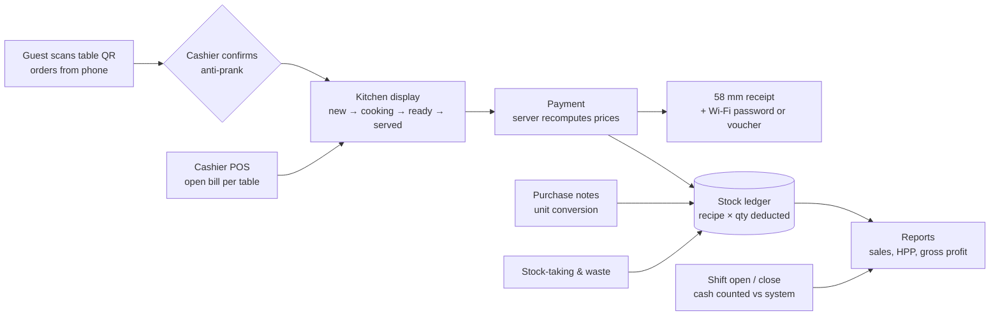

# MODA Cafe ERP — point of sale, recipes and stock for a cafe

> **Showcase repository.** The production source code is private. This repo holds a description of the system, a flow diagram and a few rewritten, runnable code samples. It contains no production code, data, accounts or credentials.

**MODA Cafe & Eatery** is a cafe and restaurant. **MODA ERP** runs its daily work: the cashier (POS), table ordering by QR code, the kitchen screen, recipes with automatic cost of goods, ingredient stock and sales reports. It runs on the cafe's own network with PHP and SQLite, so service keeps going when the internet is down.

## The problem it solves

- **Menu prices without known costs.** Nobody knew the real cost (HPP) and margin of each dish.
- **Ingredient stock on paper.** Waste and missing items could not be traced.
- **Cash gaps at shift end** with no record of who did what.

## Flow



## What it does

- **POS.** Menu grid with categories and sub-categories, modifiers (extra shot and so on), open bills per table, manual items, cash change calculation, and thermal 58 mm receipts.
- **Shifts.** Opening float, cash counted at close, and the difference against the system recorded.
- **Recipes & costing.** Recipe per portion → cost of goods and margin calculated automatically. Purchase prices update ingredient costs. → [`examples/Pos.php`](examples/Pos.php)
- **Stock.** Goods received per supplier note with unit conversion (kg → g), stock-taking that posts the differences, a waste log with its loss value, and every movement in one ledger.
- **Table ordering & kitchen.** QR code per table, cashier confirmation before an order reaches the kitchen, a kitchen display that refreshes every 5 seconds (red after 15 minutes), and order status visible on the guest's phone.
- **Wi-Fi on the receipt.** Prints either the Wi-Fi password or a unique voucher per receipt (batches can be generated and exported for the router).
- **Reports.** Revenue, cost of goods and gross profit per day, item and payment method.
- **Control.** Roles for owner, manager, cashier, kitchen and warehouse. Discounts above a threshold and voids need a manager. Prices are recalculated on the server. Cost and margin are visible only to owner and manager, and a daily audit log is kept.
- **Redesigned interface.** Olive, coffee and cream theme with menu photos, local fonts, Ctrl+K page search, and layouts for phone, tablet and laptop.

## Tech stack

PHP 8 · SQLite · plain JavaScript · thermal receipt printing · runs on the local network (works offline). Built with Claude Code as an AI pair programmer.

## Code samples

Rewritten from scratch for this repo, with demo data only.

```bash
php tests/run.php
```

- [`examples/Pos.php`](examples/Pos.php): unit conversion, recipe cost and margin, a server-side checkout that ignores prices sent by the browser, discount approval, service and tax, and the stock-ledger lines produced by a sale.

## Ringkasan (Bahasa Indonesia)

ERP untuk MODA Cafe & Eatery:
- kasir dengan bill per meja dan shift;
- pesan lewat QR meja dan layar dapur;
- resep dengan HPP & margin otomatis;
- stok bahan dengan buku besar, opname dan waste;
- token Wi-Fi di struk dan laporan penjualan.

Repo ini hanya etalase: kode produksi tetap privat, tanpa data asli.

---

© 2026 M Dzaky Rahadian. All rights reserved. The samples are published for reading and review.
